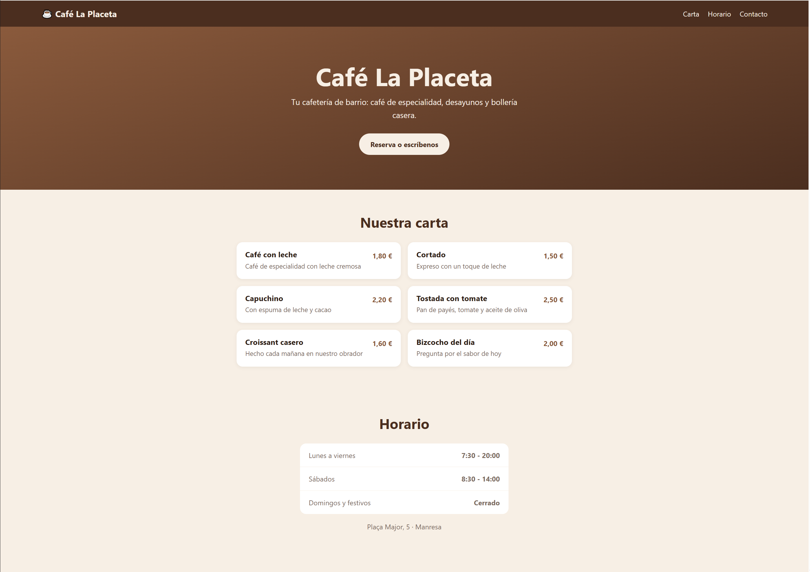
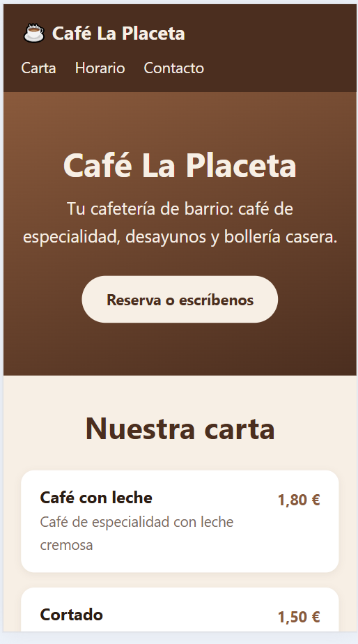

# ☕ Café La Placeta

Landing page de una cafetería de barrio, hecha con **React** como práctica de un encargo real: debía verse bien en móvil, tener un formulario de contacto que funcione y estar publicada con una URL pública.

**🔗 Ver en vivo:** https://cafeteria-placeta.vercel.app

## Capturas

| Escritorio | Móvil |
|---|---|
|  |  |

## Qué incluye

- **Portada** con llamada a la acción que lleva al formulario.
- **Carta** generada a partir de una lista de datos (`src/datos/carta.js`), sin repetir código.
- **Horario** y dirección.
- **Formulario de contacto** con validación y mensajes de error; los mensajes se guardan en Supabase.
- **Diseño adaptado a móvil** con media queries.

## Tecnologías

- React 19 + Vite
- Supabase (base de datos PostgreSQL)
- CSS propio, sin librerías
- Vercel (publicación automática con cada `git push`)

## Cómo ejecutarlo en tu ordenador

1. Clona el repositorio e instala las dependencias:

       git clone https://github.com/maryaaron80-tech/cafeteria-placeta.git
       cd cafeteria-placeta
       npm install

2. Crea un archivo `.env.local` en la raíz con tus claves de Supabase:

       VITE_SUPABASE_URL=tu_url
       VITE_SUPABASE_KEY=tu_clave_publishable

3. Crea la tabla ejecutando `supabase/esquema.sql` en el SQL Editor de Supabase.
4. Arranca el servidor: `npm run dev`

## Seguridad

La tabla `mensajes_contacto` tiene RLS activado: desde la web **solo se pueden insertar** mensajes, no leerlos. Además, la propia base de datos comprueba la longitud del nombre y del mensaje y el formato del email.

## Lo que aprendí

- Componentes, props, `useState` y formularios controlados en React.
- Variables de entorno para no subir claves al repositorio.
- Las dos capas de permisos de Supabase (`grant` + políticas RLS) y a leer los errores 404 y 401.
- Ajustes de móvil: `scroll-padding-top` para la cabecera fija y media queries.
- Publicar en Vercel configurando las variables de entorno.

## Autor

**Elias Nuñez Galarza** · [Portafolio](https://maryaaron80-tech.github.io/portafolio/) · [LinkedIn](https://www.linkedin.com/in/elias-nu%C3%B1ez-b1571b367/)
